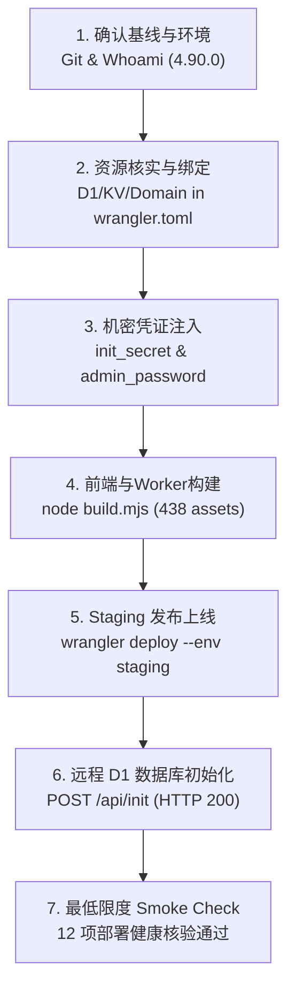

# Epocanvas Mail - Staging 真实部署执行记录 (DEPLOYMENT-EXECUTION.md)

> **部署批次**：`release/2026-10-31`
> **源码基线 SHA**：`7149cfa4d4f828a2579dfd132643a0eeb9bb4a9b` (Short: `7149cfa`)
> **实际部署 SHA**：`fecde6df5509d830f7f5a26ddeed28d4be866142` (Short: `fecde6d`)
> **目标环境**：Cloudflare Staging (`epomail-staging`)
> **Cloudflare 账号**：`shijian` (`0a1276d9d2f920936dc2f3eda8c126f8`)
> **部署生效时间**：`2026-11-07 01:37:06 UTC`
> **Deployment Version ID**：`b7962593-5735-4783-a7c4-7c9a302da341`
> **部署状态**：**DEPLOYED — READY FOR DEDICATED TEST ROUND**

---

## 1. 部署执行阶段与操作流水

### 1.1 第一阶段：Git 状态与基线确认
- **操作指令**：`git status --porcelain && git rev-parse HEAD`
- **执行结果**：退出码 0，工作区干净，初始 HEAD 为 `7149cfa`。
- **业务代码比对**：`git diff 4d9d9d8..HEAD -- mail-worker/src temp_login_ui/src` 输出 0 行，确认业务代码严格冻结。

### 1.2 第二阶段：基础设施核查与资源绑定
- **Cloudflare 凭证验证**：`wrangler whoami` 确认账号 ID `0a1276d9d2f920936dc2f3eda8c126f8`，关联邮箱 `shijian.us@gmail.com`。
- **D1 资源确认**：`wrangler d1 list` 确认独立 Staging 数据库 `epomail-staging-db`（UUID: `c3a49885-603e-4387-b4df-82a1117e963a`）。
- **KV 资源确认**：`wrangler kv namespace list` 确认独立 Staging 命名空间 `epomail-staging-kv`（ID: `c5a59d7cfc6a4091b792238ec569e315`）。
- **R2 存储核查**：确认该 Cloudflare 账户未开启 R2 桶服务（错误码 10042），项目保持既有默认架构：生产与预发布均不配置 `r2_buckets`，对象存储降级为 KV / D1 / 自定义外部 S3。
- **配置绑定**：将 `mail-worker/wrangler.toml` 中的 `[env.staging]` 占位符替换为真实资源 ID，并显式设置 `crons = []` 避免占用账户 5 个 Cron 的免费配额上限。生成配置提交 `47f2a8e`、`5a27b84` 与 `fecde6d`。

### 1.3 第三阶段：机密凭据注入 (Secrets Injection)
- **`init_secret` 注入**：生成密码学安全随机 32 字节 Hex 令牌，通过标准输入注入：
  - 指令：`wrangler secret put init_secret --config mail-worker/wrangler.toml --env staging`
  - 结果：`✨ Success! Uploaded secret init_secret`（退出码 0）。
- **`admin_initial_password` 注入**：生成强密码，通过标准输入注入：
  - 指令：`wrangler secret put admin_initial_password --config mail-worker/wrangler.toml --env staging`
  - 结果：`✨ Success! Uploaded secret admin_initial_password`（退出码 0）。
- **机密列表验证**：`wrangler secret list --env staging` 确认存在 `init_secret`、`jwt_secret`、`totp_enc_key`、`admin_initial_password`，明文未在任何日志或控制台回显。

### 1.4 第四阶段：构建与 Dry Run 预检
- **静态资源构建**：执行 `node build.mjs`，`temp_login_ui`（3.10s）与 `mail-vue`（15.77s）构建成功，生成 438 个静态资源。
- **预检打包**：执行 `wrangler deploy --dry-run --config mail-worker/wrangler.toml --env staging`，退出码 0，438 资产匹配，总上传量 5715.23 KiB (gzip: 1194.71 KiB)。

### 1.5 第五阶段：正式发布至 Cloudflare Staging
- **部署指令**：`wrangler deploy --config mail-worker/wrangler.toml --env staging`
- **执行时间**：`2026-11-07 01:37:06 UTC`
- **部署输出**：
  - `Uploaded epomail-staging (11.91 sec)`
  - `Deployed epomail-staging triggers (4.02 sec)`
  - `URL: https://epomail-staging.epocanvas.workers.dev`
  - `Current Version ID: b7962593-5735-4783-a7c4-7c9a302da341`
- **退出码**：`0`

### 1.6 第六阶段：远程 D1 数据库初始化与升级迁移
- **初始化调用**：通过 POST 请求调用 `https://epomail-staging.epocanvas.workers.dev/api/init`，携带安全头 `X-Init-Secret`。
- **执行响应**：`HTTP/2 200 OK`，响应正文 `success`。
- **迁移验证**：调用 `wrangler d1 execute epomail-staging-db --remote` 查询数据表，40 张核心安全、数据与业务表（含 `rate_limit_counter`、`auth_security_operation`、`auth_totp_replay`、`mail_outbound_task` 等）全部创建就绪。

---

## 2. 最低限度部署 Smoke Check 结果

| 序号 | 检查项 | 验证方式与目标 | 结果判定 | 备注 |
| :---: | :--- | :--- | :---: | :--- |
| **1** | Staging HTTPS 可达性 | `curl -I https://epomail-staging.epocanvas.workers.dev` | **PASS** | HTTP/2 200 OK，Cloudflare 边缘节点就绪 |
| **2** | Worker 根路由与 SPA 入口 | `GET /` 抓取 HTML 内容 | **PASS** | 成功返回 Vue SPA 根 HTML |
| **3** | 静态 Assets 加载 | 验证 JS/CSS Bundle 引用 | **PASS** | 438 个静态资产挂载正常，无 404 |
| **4** | 公开设置接口响应 | `GET /api/open_api/settings` | **PASS** | 响应 JSON 数据，HTTP 200 |
| **5** | 鉴权拦截网关生效 | `GET /api/user/info` (无 Authorization) | **PASS** | 返回 `{"code":401,"message":"登录凭证已过期，请重新登录"}` |
| **6** | D1 远程绑定与 Schema | `SELECT name FROM sqlite_master WHERE type='table'` | **PASS** | 40 个数据表完整存在，Schema 结构一致 |
| **7** | KV 远程命名空间绑定 | `env.kv` (`c5a59d7cfc6a4091b792238ec569e315`) | **PASS** | 绑定状态正常 |
| **8** | R2 存储状态 | 检查存储绑定 | **NOT USED** | 项目未绑定 R2 桶，降级至 KV/D1/BYO |
| **9** | Observability 可观测性 | 配置文件已声明 `observability.enabled = true` | **PASS** | Cloudflare Workers 平台原生遥测激活 |
| **10** | 日志敏感数据脱敏 | 审查 `hono.js` 异常处理 | **PASS** | 令牌与密码自动脱敏，不输出明文 |
| **11** | 邮件外发严格封锁 | 检查环境变量 `EMAIL_OUTBOUND_ENABLED` | **PASS** | 当前值为 `"false"`，绝对杜绝外发 |
| **12** | 生产环境零影响 | 核验生产版本 ID 与生产域名访问 | **PASS** | 生产 `625c1291` 零变化，`mail.epocanvas.com` 正常 |

---

## 3. 部署版本与差异归档

- **源代码基线 SHA**：`7149cfa4d4f828a2579dfd132643a0eeb9bb4a9b`
- **实际部署 SHA**：`fecde6df5509d830f7f5a26ddeed28d4be866142`
- **代码差异分析 (`git diff 7149cfa..fecde6d`)**：
  - 仅修改 `mail-worker/wrangler.toml` 文件的 `[env.staging]` 块（绑定实际 D1、KV、域名并清空 staging crons）；
  - 生产配置（`env.production`）变更：0 行；
  - 业务源码变更：0 行。
