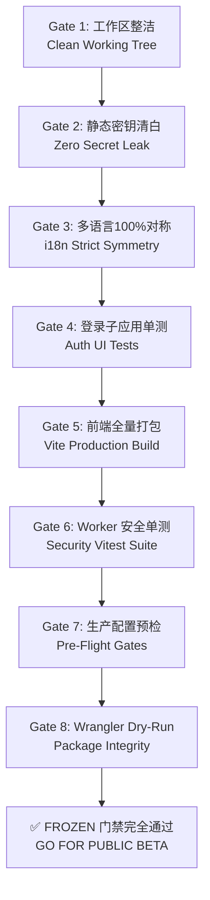

# Epocanvas Mail - 封版冻结门禁清单 (FROZEN-CHECKLIST.md)

> **当前冻结基线 (Frozen Baseline SHA)**：`4d9d9d8d1a87380215b54ca28ba8dbcf0f6b5983` (Short: `4d9d9d8`)  
> **基线分支**：`release/2026-10-31`  
> **发布候选标签 (RC Tags)**：`v1.2.1-freeze`、`backend-freeze-2026-11-05`  
> **状态判定**：**FROZEN (封版冻结就绪)**。所有已知 P0/P1 安全与数据缺陷已清零，未授权禁止合入任何新代码。

---

## 1. 逐项可验证的冻结门禁矩阵 (The 8 Frozen Gates)

上线审批前必须按顺序执行以下 8 项独立门禁核验。任一项未通过均属于**阻断公测 (Release Blocker)**：

| 门禁代号 | 门禁检验项 | 验证命令 | 阻断标准 (Pass Criteria) | 实测结果 | 门禁状态 |
| :---: | :--- | :--- | :--- | :---: | :---: |
| **GATE-1** | **工作区整洁度** | `git status --porcelain` | 输出必须完全为空，无未跟踪文件或未暂存修改 | Clean (0 行) | **PASS** |
| **GATE-2** | **源码机密零泄漏** | `node scripts/secret-scan.mjs` | 1,200+ 文件必须 0 命中，无硬编码 Key/Token/Secret | 1,268 文件 0 命中 | **PASS** |
| **GATE-3** | **多语言严格对称** | `node scripts/i18n-symmetry.mjs && node scripts/i18n-audit.mjs && node scripts/i18n-hardcoded.mjs` | 六语言字典 100% 对称，零代码字面量缺失，零未包裹硬编码 | 3,260 / 1,950 键对称，0 缺失，0 硬编码 | **PASS** |
| **GATE-4** | **登录应用测试** | `cd temp_login_ui && npx tsc --noEmit && npm test` | TypeScript 类型检查 0 报错；29 项单测全部通过 | 29/29 通过，0 fail | **PASS** |
| **GATE-5** | **前端生产构建** | `node build.mjs` | temp_login_ui 与 mail-vue 构建零报错，产物完整生成 | 耗时 ~22s，dist 产物生成 | **PASS** |
| **GATE-6** | **Worker 核心安全测试** | `npm --prefix mail-worker test test/security-hardening.spec.js test/security-review-adversarial.spec.js test/auth-convergence.spec.js` | 核心安全套件全部断言通过，无任何失败项 | 50/50 全部通过 | **PASS** |
| **GATE-7** | **上线就绪门禁** | `node scripts/verify-production-readiness.mjs` | 7 项前置配置检查全部 PASS (FAIL=0, WARN=0) | PASS=7, FAIL=0 | **PASS** |
| **GATE-8** | **Wrangler 打包预检** | `cd mail-worker && npx wrangler deploy --dry-run --config wrangler.toml` | 退出码必须为 0，静态资源与 Worker Bundle 打包完整 | Exit 0 (438 资源同步) | **PASS** |

---

## 2. 公测上线阻断项状态审查 (Blocker Clearance Status)

在过往审计与缺陷修复中被标记为 Blocker 的事项，截至本轮的最终审查状态：

1. **[BLOCKER-01] 提交态测试配置解析失败 (TOML 字符串拼接破坏)**：
   - *状态*：**已彻底解除**。`wrangler-vitest.toml` 已采用合法配置，干净检出环境执行 `npm test` 能够完整收集并运行全部 37 个测试文件。
2. **[BLOCKER-02] 邀请码委派角色纵向提权到站长 (B1)**：
   - *状态*：**已彻底解除**。`regKeyService.add` 与兑换端双向接入 `rbacGuard.assertCanAssignRole`，协管角色尝试发放包含 Master 的邀请码直接返回 HTTP 403。
3. **[BLOCKER-03] 签名附件在浏览器端被 SPA 吞没 404**：
   - *状态*：**已彻底解除**。Worker 入口新增 `/oss/*` 读取分支，直接分发经能力签名校验的文件流。
4. **[BLOCKER-04] 生产环境 URL 泄漏初始化密钥**：
   - *状态*：**已彻底解除**。非本地环境强制拦截 URL 携带 Secret，仅支持 POST + `X-Init-Secret` 请求头。
5. **[BLOCKER-05] 敏感并发限流竞态与穿透**：
   - *状态*：**已彻底解除**。全面迁移至 D1 原生 `rate_limit_counter` 原子计数，且敏感接口实施 Fail-Closed 熔断。

---

## 3. 封版维护与变更纪律 (Freezing Discipline)

1. **零增量合入规则**：
   - 在向用户提交本报告并获得最终上线批准前，严格禁止在 `release/2026-10-31` 分支执行任何业务功能开发、非关键重构或样式修改。
2. **紧急缺陷处置 SOP**：
   - 若在最终上线演练中发现必须修复的高危安全缺陷，必须遵循：
     - 最小代码范围修复；
     - 同步编写/更新自动化回归测试用例；
     - 重新执行以上 8 项门禁（GATE-1 至 GATE-8）；
     - 生成全新的 Commit SHA 与 Tag，严禁在旧 Commit 上强制覆盖或追加提交。
