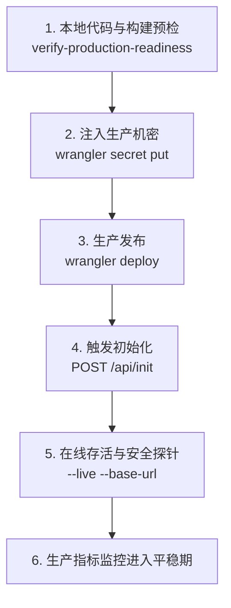

# EpoMail 生产上线发布运行手册 (Production Release Runbook)

> **版本发布批次**：`release/2026-10-31`
> **更新日期**：`2026-11-05`
> **代码冻结基线 (Backend Freeze SHA)**：`a4f262337bf58aed6927bdff5a11999b3c26003a` (Short: `a4f2623`)
> **Git 标签**：`backend-freeze-2026-11-05`
> **报告与归档基线**：`6818773b813ea23e5b6ffd5f09fe3bb32797f0e4` (Short: `6818773`)
> **适用目标**：生产环境 Cloudflare Worker、D1 Database、KV Namespace、Assets 静态分发。

---

## 1. 发布门禁与准入核验矩阵 (Pre-Flight Gates)

在推进任何生产操作之前，必须执行全自动门禁核验。全部通过方可进入部署环节：

```bash
# 执行生产发布全量门禁静态核验
node scripts/verify-production-readiness.mjs

# 执行离线密钥扫描门禁
node scripts/secret-scan.mjs

# 执行多语言严格对称与零硬编码核验
node scripts/i18n-symmetry.mjs && node scripts/i18n-audit.mjs && node scripts/i18n-hardcoded.mjs
```

| 门禁项 | 核验标准 | 对应命令 / 工具 | 必须状态 |
| :--- | :--- | :--- | :---: |
| **P0/P1 安全漏洞** | 无未关闭的 P0 阻断性漏洞或 P1 一致性断链 | 专项审计报告 `doc/backend-freeze-2026-11-05.md` | **PASS (0 项)** |
| **工作区状态** | Git 分支对齐且无未审查脏代码 | `git status --porcelain` | **PASS** |
| **多语言闭环** | 6 语言字典 100% 对称，零硬编码 | `scripts/i18n-symmetry.mjs` | **PASS** |
| **密钥隔离** | 仓库与构建产物零明文凭证 | `scripts/secret-scan.mjs` | **PASS (0 secrets)** |
| **前端完整性** | `mail-vue` 与 `temp_login_ui` 打包无误 | `node scripts/verify-production-readiness.mjs` | **PASS** |
| **生产打包** | Cloudflare dry-run 构建零报错 | `wrangler deploy --dry-run` | **PASS (Exit 0)** |

---

## 2. 生产机密安全注入矩阵 (Production Secrets Matrix)

生产凭据**严禁**写入任何受 Git 追踪的配置文件中。必须在部署前通过 Cloudflare CLI (`wrangler secret put`) 注入：

```bash
# 切换至 mail-worker 目录
cd mail-worker

# 1. JWT 核心签名主密钥 (必须高强度随机 32+ 字符)
npx wrangler secret put jwt_secret

# 2. TOTP 与敏感凭据 AES-256-GCM 主加密密钥 (32 字节高强度随机字符串)
npx wrangler secret put totp_enc_key

# 3. 邮件密文静态存储加密密钥 (32 字节随机字符串)
npx wrangler secret put email_enc_key

# 4. 独立初始化鉴权密钥 (必须独立于 jwt_secret，严禁通过 URL 传递)
npx wrangler secret put init_secret

# 5. 首次初始化站长管理员密码 (仅在首次冷启动建号时使用，长度 ≥ 8 位)
npx wrangler secret put admin_initial_password

# 6. Resend Webhook 验签密钥 (若启用 Resend 投递回调，需填入 Svix Secret)
npx wrangler secret put resend_webhook_secret
```

### 生产 Secret 详细说明表

| Secret 键名 | 敏感度 | 用途说明 | 缺失或错误后果 | 轮换影响 |
| :--- | :---: | :--- | :--- | :--- |
| `jwt_secret` | **高危** | 用户 JWT 鉴权与对象安全签名 | 全站 401 鉴权拒绝，服务瘫痪 | 用户需重新登录；旧签名链接失效 |
| `totp_enc_key` | **高危** | TOTP 两步验证码解密 | 开启 2FA 用户登录报 500 | 需在数据库批量重置用户 2FA 绑定 |
| `email_enc_key` | **高危** | 邮件密文存储解密 | 加密邮件正文与搜索无法解密 | 存量加密邮件需按旧 Key 迁移 |
| `init_secret` | **高危** | `/api/init` 系统升级/建表权限 | 拒绝执行冷启动或架构升级 DDL | 无运行时影响，仅影响运维操作 |
| `admin_initial_password` | **重要** | 站长初始密码（首次建号） | 冷启动拒绝创建初始管理员 | 仅建号生效，后续通过改密管理 |
| `resend_webhook_secret` | **普通** | Webhook 回调 Svix 验签 | Webhook 拒绝接入并记入 Outbox | 需与 Resend 控制台同步更新 |

---

## 3. D1 数据库与 Schema 幂等升级规范 (Database Migration)

当前发布包含新增的限流表 `rate_limit_counter`、转发持久化表 `mail_forward_task` 以及 OAuth 单次凭证表 `oauth_one_time_credential`。

### 3.1 零停机迁移原理
后端在升级函数中通过 `PRAGMA table_info` 实行**条件式探测（Idempotent Check）**，保证无论重复调用多少次 `/api/init`，均不会引发表冲突或字段重复报错。同时，敏感限流逻辑在极端升级窗口内具备缺表自愈能力（一次性自建 schema 并重试计数）。

### 3.2 部署后触发数据库初始化命令
在 Worker 代码推送到生产后，**立即通过安全信道触发初始化**：

```bash
# 通过 POST 请求携带 Header 触发系统初始化 (生产环境严禁通过 URL Query 参数传递)
curl -X POST https://<您的生产主域名>/api/init \
  -H "Content-Type: application/json" \
  -H "x-init-secret: <您的 init_secret 生产密钥>"
```

**期望响应**：
```json
{
  "code": 200,
  "message": "Init success",
  "data": {
    "initialized": true
  }
}
```

---

## 4. 生产部署标准操作程序 (Deployment SOP)



### 步骤 1：本地构建与打包产物生成
```bash
# 确保依赖与构建处于干净状态
cd mail-worker
node ./build.mjs
```

### 步骤 2：执行正式部署
```bash
# 部署至 Cloudflare 生产环境
npx wrangler deploy
```

### 步骤 3：执行冷启动初始化
```bash
curl -X POST https://<您的生产主域名>/api/init \
  -H "x-init-secret: <您的 init_secret>"
```

### 步骤 4：自动化在线安全探针核验
```bash
# 运行生产存活与敏感限流探针 (零破坏性探针)
node scripts/verify-production-readiness.mjs \
  --base-url https://<您的生产主域名> \
  --init-secret <您的 init_secret>
```

---

## 5. 上线后人工抽检与冒烟核验 (Post-Deployment Verification)

完成自动化核验后，请按以下顺序执行 5 分钟人工冒烟：

1. **登录与会话建立**：
   - 访问 `https://<域名>/login/`，使用管理员账号登录；
   - 检查 JWT Token 正常发放，页面正常跳入收件箱；
   - 检查控制台无 500/503 报错，无跨域拦截。
2. **入站邮件与限流**：
   - 从外部邮箱向站内邮箱发送一封测试邮件；
   - 观察收件箱是否于 5 秒内显示该邮件；
   - 连续错误输入登录密码，确认触发限流保护而非未捕获异常。
3. **法律告知与隐私设置**：
   - 访问系统设置 -> 法律条款与隐私偏好；
   - 确认 6 种语言切换流畅，文案完全匹配。

---

## 6. 10 项已知 P2 架构受限事项在生产运营中的处置指引

| # | P2 受限项目 | 生产运维与安全控制措施 |
| :- | :--- | :--- |
| **1** | **DNS Rebinding** | BYO 对象存储已在连接测试路径通过 DoH 私网过滤。**生产指引**：在控制台要求用户仅绑定公网受信域名（如 `*.r2.cloudflarestorage.com` 或 `*.amazonaws.com`）。 |
| **2** | **MTA 认证头依赖** | 若使用了外部自建 Postfix/Haraka 收信，**必须**在 `wrangler.toml` 的 `[vars]` 中配置 `INBOUND_AUTHSERV_ID = "您的MTA主机名"`，确保内部邮件防冒领机制生效。 |
| **3** | **Cloudflare Email 对账** | Cloudflare Email 无外发状态查询 API。**生产指引**：在运维控制台定期检查外发任务表，对于超过 2 小时仍为 UNKNOWN 的任务进行人工确认。 |
| **4** | **OAuth Passkey Step-up** | 内联 OAuth 页面当前支持密码、TOTP 与备用码。若用户仅有 Passkey，引导其在主登录页先完成会话授权。 |
| **5** | **存储 Locator 变更** | 系统级存储桶在切换时不自动转移历史数据。**生产指引**：上线后禁止随意更改生产系统 R2/S3 桶名，如需割接须配合离线对象同步工具（如 rclone）。 |
| **6** | **Telegram 测试限流** | 用户未保存 personalTelegram 前每次测试 Token 受 10次/15分钟限流。监控 `/my/testTelegram` 的调用频率，防范代理探测。 |
| **7** | **公开 Profile 邮箱掩码** | 本人查看公开 Profile 同样显示掩码。已在帮助中心向用户说明该机制为防爬虫保护。 |
| **8** | **转发失败管理 UI** | `mail_forward_task` 暂无独立管理端看板。**生产指引**：通过 D1 查询 `SELECT * FROM mail_forward_task WHERE status = 'FAILED' LIMIT 50;` 跟踪异常。 |
| **9** | **加密搜索 10,000 条截断** | 属于防范 Worker CPU 耗尽的保护设计。向大容量用户说明在密文模式下应结合时间范围精确检索。 |
| **10** | **升级自建表兜底** | 部署后必须严格按照步骤执行 `/api/init`，避免让终端用户的日常请求触发降级 DDL 重试。 |

---

## 7. 紧急回滚与灾难恢复预案 (Rollback & Disaster Recovery)

若上线后发生严重故障（如大面积鉴权失效或数据库不可读），立即启动回滚程序：

### 7.1 Worker 代码快速秒级回滚
Cloudflare 支持版本即时回滚，无需重新打包编译：
```bash
# 查看近期部署的版本版本列表
npx wrangler versions list

# 秒级回滚至上一个稳定版本 ID
npx wrangler rollback <上一版本_VERSION_ID> --message "Emergency rollback to previous stable version"
```

### 7.2 D1 数据库时间点恢复 (Point-in-Time Recovery)
若数据库发生逻辑污染：
```bash
# 1. 导出当前受损数据留存分析
npx wrangler d1 export epomail --output ./emergency-backup-$(date +%s).sql

# 2. 从 Cloudflare 控制台使用 D1 Time Travel 恢复到升级前时间戳
npx wrangler d1 time-travel restore epomail --timestamp="<部署前Unix时间戳>"
```

### 7.3 灾难联系人与沟通升级
*   发现高危数据或服务不可用，先切换 Cloudflare 维护页面（Under Attack / Maintenance Mode）。
*   检查 Worker Realtime Logs：`npx wrangler tail`。
